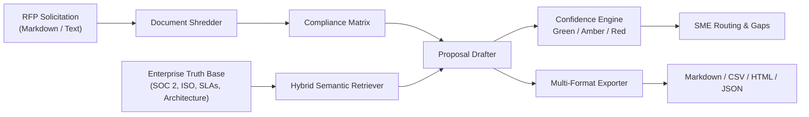

# OpenRFP: Autonomous AI Proposal & RFP Response Agent

[](https://github.com/PatelDeepB/open-rfp/actions/workflows/ci.yml)
[](https://opensource.org/licenses/MIT)
[](https://www.python.org/downloads/)
[](#)

> **Autonomous AI RFP and proposal response engine:** solicitation shredding, compliance matrix extraction, semantic knowledge base retrieval, context-aware proposal drafting, gap analysis, and multi-format delivery.

---

## The Problem: The $20,000 RFP Bottleneck

Responding to complex enterprise RFPs (Requests for Proposal) and security questionnaires consumes **20 to 40 hours per document** across sales reps, presales solution architects, legal, and infosec leads. 

- **65% to 72% of sales rep time** is lost to manual administrative paperwork.
- **Slow response times kill deals:** Procurement shortlists competitors who respond in days, not weeks.
- **Copy-paste risk:** Reusing outdated answers introduces hallucinated capabilities and compliance liabilities.
- **Internal coordination drag:** Hunting down 5 different department leads for missing answers creates endless email and Slack tag.

**OpenRFP turns 20 to 40 hours of manual RFP grunt work into a 15-minute review process.**

---

## Key Capabilities

- **RFP Document Shredder:** Ingests solicitations and automatically isolates discrete requirements into a structured **Compliance Matrix** with category and priority classifications.
- **Enterprise Truth Repository:** Semantic knowledge base indexed by domain (SOC 2, ISO 27001, SLAs, Cloud Architecture, Integrations, Legal/GDPR).
- **Zero-Hallucination Drafting:** Synthesizes persuasive proposal answers strictly grounded in verified enterprise documentation with source citations.
- **Traffic-Light Confidence Scoring:**
  - <span style="color:#10b981">**Green (Verified)**</span>: Direct verified match with cited evidence.
  - <span style="color:#f59e0b">**Amber (Partial/Review)**</span>: Partial match with explicit assumption warnings for human review.
  - <span style="color:#ef4444">**Red (Knowledge Gap)**</span>: Missing capability flagged for immediate SME intervention.
- **Automated SME Routing:** Groups gaps by department (Security, Cloud, Legal, Pricing, Product) and auto-generates targeted micro-questions.
- **Multi-Format Exporter:** Generates submission-ready Markdown proposals, CSV compliance matrices, printable executive HTML reports, and structured JSON.
- **Rich CLI & Interactive Web UI:** Full command-line toolkit and embedded browser dashboard.

---

## Architecture Overview



---

## Quickstart

### 1. Installation

```bash
# Clone the repository
git clone https://github.com/PatelDeepB/open-rfp.git
cd open-rfp

# Create and activate virtual environment
python -m venv venv
source venv/bin/activate  # Windows: .\venv\Scripts\activate

# Install in editable mode
pip install -e ".[dev]"
```

### 2. Seed Enterprise Knowledge Base

Populate your verified truth records (SOC 2, ISO 27001, SLAs, Architecture):

```bash
open-rfp kb seed
open-rfp kb list
```

### 3. Shred an RFP Solicitation

Extract a structured compliance matrix from any RFP document:

```bash
open-rfp shred data/samples/sample_rfp.md --buyer "Apex Global Financial"
```

### 4. Synthesize Proposal & Export Deliverables

Run end-to-end proposal generation and save outputs:

```bash
open-rfp draft data/samples/sample_rfp.md --buyer "Apex Global Financial" --output-dir ./deliverables
```

This generates:
- `./deliverables/sample-rfp-proposal.md` (Formal Markdown proposal)
- `./deliverables/sample-rfp-proposal-matrix.csv` (Procurement-ready CSV)
- `./deliverables/sample-rfp-proposal.html` (Standalone executive HTML report)
- `./deliverables/sample-rfp-proposal.json` (Structured JSON API payload)

### 5. Launch Interactive Web UI & API Server

```bash
open-rfp serve --host 0.0.0.0 --port 8000
```

Open `http://localhost:8000` in your browser to access the dashboard.
Open `http://localhost:8000/docs` for the interactive OpenAPI documentation.

---

## REST API Reference

| Method | Endpoint | Description |
|---|---|---|
| `GET` | `/health` | Health check probe and indexed knowledge count |
| `POST` | `/api/v1/rfp/parse` | Shred raw solicitation text into a compliance matrix |
| `POST` | `/api/v1/rfp/parse-and-draft` | Full pipeline: parse, match truth, synthesize proposal |
| `GET` | `/api/v1/rfp` | List all saved RFPs |
| `GET` | `/api/v1/rfp/{rfp_id}` | Retrieve specific RFP details |
| `POST` | `/api/v1/knowledge` | Add verified enterprise truth item |
| `GET` | `/api/v1/knowledge` | List all enterprise truth items |
| `POST` | `/api/v1/knowledge/search` | Search knowledge base using hybrid semantic match |
| `GET` | `/api/v1/proposal/{rfp_id}` | Retrieve synthesized proposal summary |
| `GET` | `/api/v1/proposal/{rfp_id}/export/{format}` | Export proposal in markdown, csv, html, or json |

---

## Docker Deployment

Run with Docker Compose:

```bash
docker-compose up -d
```

Or build manually:

```bash
docker build -t open-rfp .
docker run -p 8000:8000 open-rfp
```

---

## Testing

OpenRFP maintains rigorous test coverage (>90%) with fast unit and integration tests:

```bash
# Run test suite
pytest tests/ -v

# Run with coverage report
pytest tests/ --cov=openrfp --cov-report=term-missing
```

---

## License

This project is licensed under the MIT License. See [LICENSE](LICENSE) for details.
