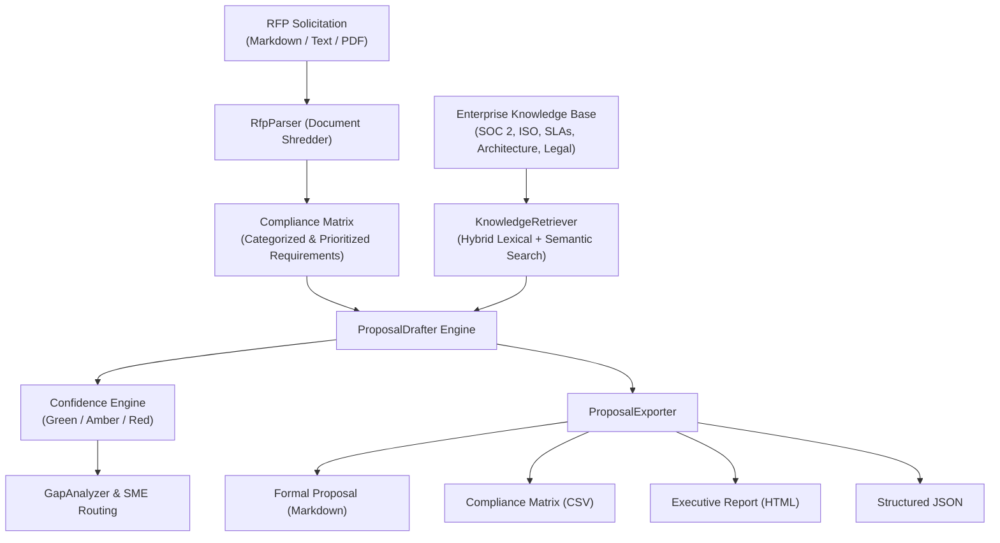

# OpenRFP Architecture & System Design

## 1. High-Level System Architecture

OpenRFP is designed as an autonomous agent that ingests B2B Request for Proposal (RFP) solicitations, extracts requirements into a structured compliance matrix, performs hybrid semantic search over an enterprise truth repository, and synthesizes grounded, non-hallucinated proposal deliverables.

## 2. Core Modules

### 2.1 Document Shredder (`openrfp.core.parser`)
- Ingests solicitations from plain text or Markdown.
- Segments text into logical sections based on headers or numbered blocks.
- Identifies individual requirements using bullet points, numbered items, and modal phrasing ("shall", "must", "required").
- Classifies each requirement into functional categories:
  - Security & Compliance
  - Technical Architecture
  - Integrations & APIs
  - SLA & Support
  - Legal & Terms
  - Pricing & Commercials
  - Functional Specifications

### 2.2 Truth Retrieval (`openrfp.core.retriever`)
- Implements hybrid retrieval balancing exact query token coverage with title, tag, and category context bonuses.
- Ensures zero hallucination by strictly grounding answers in verified enterprise citations.

### 2.3 Drafting & Confidence Scoring (`openrfp.core.drafter`)
- Assigns a traffic-light confidence score to each draft response:
  - **Green (Verified)**: Direct high-confidence match with verified knowledge base citation.
  - **Amber (Partial/Review)**: Partial alignment requiring review of specific assumptions or configurations.
  - **Red (Knowledge Gap)**: Missing capability or unverified requirement routed to specialists.
- Computes overall Win Probability Readiness Score based on compliance coverage and confidence distribution.

### 2.4 Gap Analysis & SME Routing (`openrfp.core.gap_analyzer`)
- Isolates all Red and Amber requirements.
- Automatically generates targeted micro-questions for Subject Matter Experts (SMEs).
- Routes tasks by department:
  - Security & Infosec
  - Cloud & Engineering
  - Product Management
  - Legal & Contracts
  - Finance & Pricing

### 2.5 Multi-Format Exporter (`openrfp.core.exporter`)
- Compiles the final deliverable into:
  - Markdown: Complete proposal with Executive Summary and Compliance Appendix.
  - CSV: Standard compliance matrix spreadsheet for procurement upload.
  - HTML: Executive-ready standalone visual proposal report.
  - JSON: Machine-readable payload for CRM or ERP ingestion.
